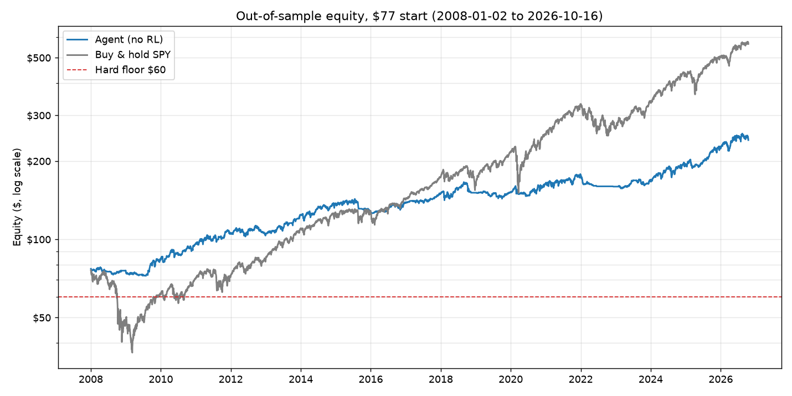
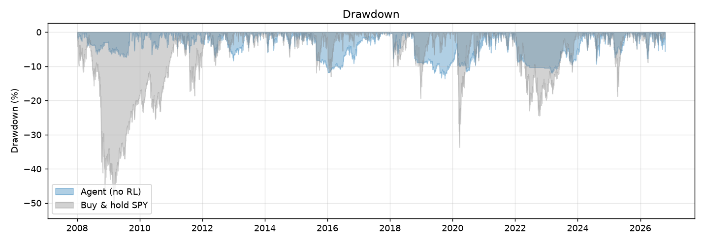
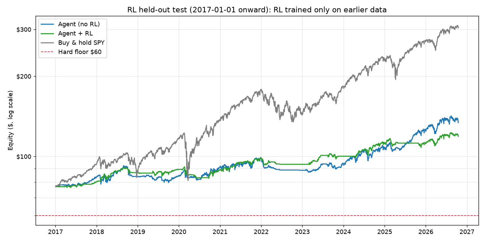
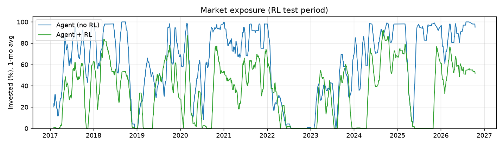
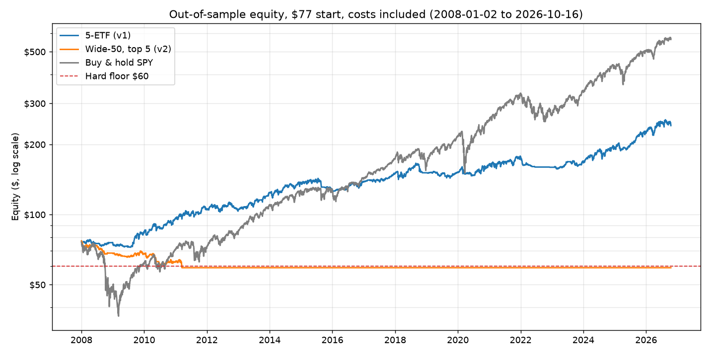
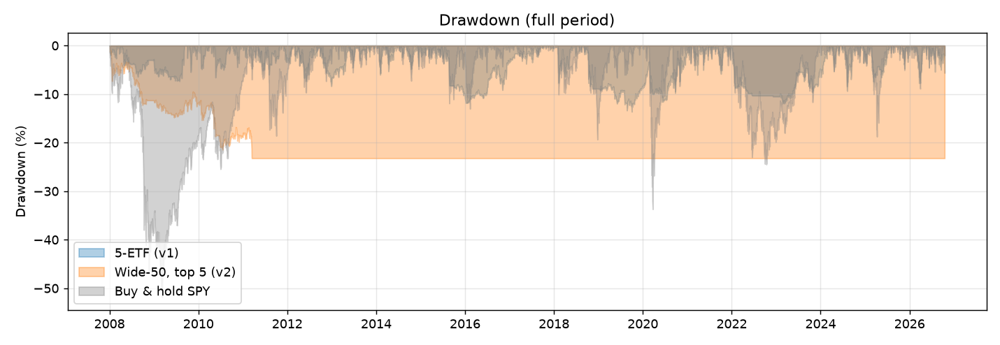

# Risk-managed ETF trading agent

[](https://github.com/OWNER/REPO/actions/workflows/ci.yml)


-yellow)


A small, end-to-end trading system that I actually run with real (tiny) money. It forecasts
next-day returns for five liquid ETFs with **ETS, ARIMA and gradient boosting**, trades only
when the ensemble is confident, and wraps every order in a **risk engine that can't be
bypassed**: volatility sizing, drawdown brakes, a daily loss cap, a Pattern-Day-Trader guard and
a **hard floor that liquidates and permanently halts at $60 of a $77 account**. An optional
**PPO reinforcement-learning** module learns *how much* exposure to take, never *what* to buy,
and is benchmarked against the plain version.

The goal isn't to "beat the market at any cost". It's to **match a market-like risk-adjusted
return with a fraction of the drawdown**, verified honestly out-of-sample and then live.

> **Not financial advice.** This is an educational/portfolio project. Trading involves risk of
> loss; past (and backtested) performance does not predict future results.

---

## Results (out-of-sample, walk-forward, with costs)

**Full out-of-sample period: Jan 2008 to Oct 2026, $77 start, costs included**

| Metric | Agent (no RL) | Buy & hold SPY |
|---|---|---|
| CAGR | 6.3% | 11.3% |
| Total return | 213% | 641% |
| Volatility (ann.) | 9.2% | 19.7% |
| **Sharpe** | **0.71** | 0.64 |
| Sortino | 0.85 | 0.78 |
| **Max drawdown** | **−13.6%** | −51.9% |
| Win rate (closed trades) | 60% | n/a |
| Avg. exposure | 63% | 100% |
| # orders | 1,922 | 1 |
| Floor ($60) triggers | 0 | n/a (would have breached: low of $36.63) |
| Lowest equity | $72.34 | $36.63 |
| Ending equity | $240.84 | $564.16 |

**RL comparison on held-out data (2017 to Oct 2026; PPO trained only on 2008–2016)**

| Metric | Agent (no RL) | Agent + RL | Buy & hold SPY |
|---|---|---|---|
| CAGR | 5.8% | 4.5% | 15.1% |
| Volatility (ann.) | 9.5% | 6.6% | 18.1% |
| Sharpe | 0.65 | 0.71 | 0.87 |
| Max drawdown | −13.6% | −9.5% | −33.7% |
| Avg. exposure | 63% | 35% | 100% |
| Ending equity | $133.92 | $118.93 | $303.83 |

The RL scaler learned to be a **de-risker**: on data it never saw, it cut volatility by about a
third and max drawdown from 13.6% to 9.5% (a slightly better Sharpe) at the cost of return. In
this period, a strong bull market, buy-and-hold SPY beat both versions on return *and* Sharpe.
That's reported as-is.

| Full period equity ($77 start, log scale) | Drawdowns |
|---|---|
|  |  |

| RL held-out test: agent vs agent+RL vs SPY | Exposure (how much is invested) |
|---|---|
|  |  |

### Experiment: does a wider universe help? (No, so the 5 ETFs stay the default)

I also built a **wide-universe version (v2)**: 26 long-lived ETFs plus 24 stocks that were
the largest US companies at the end of 2007, chosen point-in-time to limit survivorship bias.
Each day it ranks them by forecast strength and holds only the best 5, with volatility
sizing, a 40% sector cap, a correlation filter, a 10% portfolio-volatility cap and fractional
shares. It ran on the same engine, costs and periods:

| Same periods, $77 start, costs included | 5-ETF v1 (default) | Wide-50 v2 | Buy & hold SPY |
|---|---|---|---|
| **2008–2026** CAGR / Sharpe | **6.26% / 0.71** | −1.40% / −0.42 | 11.25% / 0.64 |
| 2008–2026 max drawdown | **−13.6%** | −23.2% (**$60 floor hit, Mar 2011**) | −51.9% |
| 2008–2016 CAGR / Sharpe | 6.69% / 0.78 | −2.90% / −0.61 | 7.17% / 0.43 |
| 2017–2026 CAGR / Sharpe | 5.82% / 0.65 | 0.48% / 0.10 | 15.06% / 0.87 |
| 2017–2026 max drawdown | −13.6% | −30.7% | −33.7% |
| Turnover 2017–2026 (× equity/yr) | 18 | 88 | n/a |

The wider universe **made things worse**. Ranking 50 near-coin-flip forecasts mostly picks
noise, the daily reshuffling caused heavy churn, and the ensemble is much better at timing
broad ETFs than at picking single stocks. I tried 8 variants (top 3 or 8, no correlation
filter, no volatility cap, holding until each name's own exit signal, ranking by
return/volatility, ETFs only), and every one of them was reported. The best, ETFs only,
reached 2.0% CAGR with a 0.29 Sharpe, still well behind v1. Full tables are in
[`docs/comparison.md`](docs/comparison.md) and the analysis is in
[`docs/METHODOLOGY.md`](docs/METHODOLOGY.md). The v2 config is kept in `configs/wide.yaml`
for anyone who wants to experiment.

| v1 vs v2 vs SPY, 2008–2026 | Drawdowns |
|---|---|
|  |  |

A self-contained HTML version (all charts, metrics and the last orders) is in
[`docs/report.html`](docs/report.html); full tables are in [`docs/results.md`](docs/results.md).

**How to read this:** the agent gives up a lot of bull-market upside (on average about 37% of
the account sits in cash, and positions are sized to ~10% volatility), in exchange for roughly
**¼ of SPY's maximum drawdown**. In 2008–09 buy-and-hold SPY turned $77 into $36.63, far
through the $60 floor, while the agent's lowest point was $72.34.

---

## Architecture

```mermaid
flowchart LR
    subgraph Data
        YF["yfinance daily bars<br/>Alpaca IEX fallback"] --> CACHE[("CSV cache")]
    end
    subgraph Forecasting
        CACHE --> ETS["ETS<br/>Holt damped trend"]
        CACHE --> ARIMA["ARIMA<br/>order by AIC"]
        CACHE --> GBM["Gradient boosting<br/>lagged returns / vol / trend"]
        ETS --> ENS{{"Ensemble<br/>P up, mean, agreement,<br/>confidence"}}
        ARIMA --> ENS
        GBM --> ENS
    end
    ENS --> SIG["Signal rules<br/>confidence threshold + hysteresis<br/>+ 200-day trend filter"]
    SIG --> RISK
    RL["PPO exposure scaler<br/>optional, scale 0..1"] -.-> RISK
    subgraph RISK["Risk engine - authoritative"]
        direction TB
        R1["Hard floor $60 -> liquidate + kill file"]
        R2["Vol sizing, max position, cash only"]
        R3["Drawdown brakes, daily loss cap"]
        R4["PDT guard: 3 day trades / 5 days"]
    end
    RISK --> PLAN["Order planner<br/>sells first, $1 min, rebalance band"]
    PLAN --> GUARD["GuardedBroker<br/>validate_order on EVERY order"]
    GUARD --> SIM["SimBroker<br/>backtests"]
    GUARD --> ALP["Alpaca<br/>paper default / live"]
    ALP --> LEDGER[("SQLite ledger + CSV")]
    IEX["Alpaca IEX live prices"] --> MON["Intraday monitor<br/>every 15-20 min / loop"]
    MON -->|"floor / drawdown / daily loss"| GUARD
    LEDGER --> DASH["Streamlit dashboard<br/>+ static HTML report"]
```



The backtester and the live runner share the same forecasting, signal, risk and
`GuardedBroker` code; only the broker adapter differs (simulated fills vs Alpaca).

### How it works

| Stage | What happens |
|---|---|
| **Forecast** | Every symbol gets three next-day forecasts. **ETS** (statsmodels `ExponentialSmoothing`, additive damped trend on log prices) and **ARIMA** (statsmodels, best of (1,0,0)/(0,0,1)/(1,0,1) by AIC) are refit every 21 days on a 2-year window and updated daily in between. A pooled **HistGradientBoosting** model (lagged returns, momentum, volatility, moving-average distance, RSI, market regime) predicts P(5-day return > 0) and is retrained every quarter on an expanding window, with a strict label-leakage guard. |
| **Ensemble** | Each model gives a mean and P(up) = Φ(μ/σ). Blended with weights 25/25/50 into `p_up`, `mu`, `agreement` (models with μ > 0) and `confidence = 2·|p_up − 0.5|`. |
| **Signal** | Long when `p_up ≥ 0.55`, ≥ 2 of 3 models agree and price > its 200-day average; stay long while `p_up ≥ 0.50` (hysteresis cuts churn). Otherwise **cash**. |
| **Risk** | weight = min(35%, 10% target vol ÷ EWMA vol); gross ≤ 98%; drawdown ≥ 8% → half size, ≥ 12% → flat for 10 days; −3% day → no new buys; **equity ≤ $60 → sell everything, write `state/HALT`, never trade again** until a human deletes it. |
| **Execute** | Decide at the close, trade at the next session (~09:50 ET) with fractional, dollar-amount market orders. Sells first, then buys funded by cash. |
| **Monitor** | During market hours, `trading-agent monitor` re-marks holdings with Alpaca's free real-time IEX prices and uses the lower of that and the broker's equity. **≤ $60 → cancel orders, sell everything, permanent halt** (the one case allowed to break the day-trade limit). Drawdown ≥ 12% → cooldown and sell anything not bought today. Down ≥ 3% on the day → no more buying today. |

---

## Repository layout

```
.
├── configs/default.yaml          # the ONE file you edit (universe, thresholds, risk limits)
├── configs/wide.yaml             # experimental 50-symbol ranked universe (see results)
├── .env.example                  # copy to .env, add Alpaca keys (never committed)
├── src/trading_agent/
│   ├── data/loader.py            # yfinance + cache, Alpaca IEX fallback, freshness checks
│   ├── forecasting/              # features.py, models.py (ETS/ARIMA), ensemble.py (+ GBM)
│   ├── strategy.py               # long/flat signals, EWMA vol, trend filter
│   ├── risk/engine.py            # RiskEngine: sizing, floor, PDT, drawdown, per-order gate
│   ├── rl/                       # gymnasium env, PPO training, RL policy (exposure only)
│   ├── execution/                # GuardedBroker, SimBroker, AlpacaBroker, ledger, live runner,
│   │                             #   monitor.py (intraday risk monitor), lock.py
│   ├── backtest/                 # event-driven backtester, metrics, charts, HTML report, compare.py
│   ├── dashboard/app.py          # Streamlit app
│   └── cli.py                    # `trading-agent` command
├── tests/                        # pytest: risk, PDT, sizing, leakage, selection, monitor, e2e daily run
├── scripts/                      # setup.sh, run_daily.sh (cron), monitor.sh (intraday risk monitor)
├── docs/                         # METHODOLOGY.md, comparison.md, results.md, report.html, images/
└── .github/workflows/            # ci.yml (tests), daily-trade.yml, intraday-monitor.yml (free schedules)
```

---

## Quick start (about 10 minutes)

**1. Install** (Python 3.10+; macOS/Linux; on Windows use WSL or run the same commands in PowerShell)

```bash
git clone <your-repo-url> trading-agent && cd trading-agent
./scripts/setup.sh                 # creates .venv, installs everything, copies .env.example -> .env
source .venv/bin/activate
pytest                             # 87 tests, should all pass (~30 s)
trading-agent preview              # no keys needed: today's signals for a fresh $77 account
```

**2. Get free Alpaca paper keys**

1. Sign up at <https://alpaca.markets> (free; no deposit needed for paper trading).
2. In the dashboard, switch to **Paper Trading** (top-left account switcher).
3. Click **API Keys → Generate New Keys**, then copy the *Key ID* and *Secret* (the secret is shown once).
4. Open `.env` and paste them:
   ```
   ALPACA_API_KEY=PK...
   ALPACA_SECRET_KEY=...
   ```
5. Optional: in paper account settings, reset the paper balance to **$77** so it matches real life.

**3. Verify and trade on paper**

```bash
trading-agent check                # shows paper account, places NO orders
trading-agent daily --dry-run      # during market hours: full plan, no orders
trading-agent daily                # the real daily run (paper)
trading-agent dashboard            # opens http://localhost:8501
```

Other commands: `trading-agent backtest` (reproduce the results, about 12 min the first time,
then cached), `trading-agent compare --sensitivity` (v1 vs v2 vs SPY, about 15 min cold),
`trading-agent monitor [--loop] [--dry-run]` (intraday risk check), `trading-agent train-rl`,
`trading-agent status`. To try the wide universe: `trading-agent --config configs/wide.yaml preview`.

---

## Running it every day for free

The daily run is **idempotent** (a second run the same day does nothing; order IDs are
deterministic, so Alpaca itself rejects duplicates) and **fails safe** (stale data, API errors
or a blocked account mean no new orders, a logged error and a non-zero exit code).

### Option A: cron on your laptop (macOS/Linux)

```bash
crontab -e
# Daily run at 09:50 ET, Mon-Fri (set your computer's timezone to ET, or adjust the hour):
50 9 * * 1-5  /path/to/trading-agent/scripts/run_daily.sh >> /path/to/trading-agent/logs/cron.log 2>&1
# Intraday risk monitor every 15 min during market hours (floor, drawdown, daily loss):
*/15 9-15 * * 1-5  /path/to/trading-agent/scripts/monitor.sh >> /path/to/trading-agent/logs/cron.log 2>&1
```

Or keep the monitor running for the whole session: `./scripts/monitor.sh --loop` (checks every
60 s and exits after the close). The laptop must be awake at that time. On macOS: *System Settings → Battery → Options → Prevent
automatic sleeping*, or `sudo pmset repeat wakeorpoweron MTWRF 09:45:00`.

### Option B: GitHub Actions (no computer needed)

`.github/workflows/daily-trade.yml` runs the agent at 09:50 ET every weekday on GitHub's
servers. A private repo includes 2,000 free minutes a month, and this uses about 60.

1. Push the repo to GitHub (private is fine).
2. *Settings → Secrets and variables → Actions → New repository secret*: add
   `ALPACA_API_KEY` and `ALPACA_SECRET_KEY` (paper keys first).
3. *Actions → Daily trade → Run workflow* (leave **dry_run** checked) to test it.
4. `.github/workflows/intraday-monitor.yml` runs the risk monitor every 20 minutes during
   market hours (about 570 of the 2,000 free minutes; free without limit on public repos).
   Test it with *Actions → Intraday risk monitor → Run workflow* (dry_run checked).
5. That's it: the schedules run automatically. Logs and the ledger CSVs are attached to each
   run as artifacts; `state/` is carried between runs with the Actions cache.

Even if the cached state were ever lost, the important protections don't depend on it: the
floor is re-checked against the broker's live equity, PDT uses Alpaca's own `daytrade_count`,
and the drawdown peak is rebuilt from Alpaca's portfolio history.

---

## Going live: checklist

Do these in order. Don't skip the paper period.

- [ ] `pytest` passes and `trading-agent backtest` reproduces the numbers above.
- [ ] **2–4 weeks of paper trading** with the scheduler running; check the dashboard and the
      ledger (`state/orders.csv`) every few days. Every run should end `completed` or `dry_run`.
- [ ] You understand that the agent can lose money, and that the $60 floor is checked when
      the agent runs (daily, plus intraday monitor checks every 15–20 minutes), **not
      continuously**: an overnight gap can push equity below $60 before it sells.
- [ ] Open and fund a **live** Alpaca account (a cash or margin account is fine; the agent never
      uses margin). Generate **live** API keys (a different key pair from paper).
- [ ] Put the live keys in `.env` (laptop) or in the GitHub secrets (Actions).
- [ ] In `configs/default.yaml` set `execution.mode: live`. Keep `risk.initial_capital: 77`
      and `risk.hard_floor: 60` unless you deliberately change your risk.
- [ ] Laptop: add `--live` to the cron lines (`run_daily.sh --live`, `monitor.sh --live`).
      Actions: add a repository **variable** `TRADING_LIVE` = `true`.
- [ ] Run `trading-agent check --live` (read-only) and confirm it says **LIVE** with your real balance.
- [ ] First live day: run `trading-agent daily --live --dry-run` during market hours, read the
      plan, then let the schedule take over.
- [ ] Delete `state/risk_state.json` and `state/ledger.db` left over from paper if you want a
      clean live history (paper and live are recorded separately anyway).
- [ ] If the kill switch ever fires (`state/HALT`), it's **permanent by design**. Review what
      happened before you even think about deleting it.

**Two safety locks for live trading:** you need both the `--live` flag *and*
`execution.mode: live`. If either is missing, it trades paper.

---

## Backtest methodology

Full details, including the survivorship-bias discussion and the decision rule used for v1
vs v2, are in [`docs/METHODOLOGY.md`](docs/METHODOLOGY.md).

- **Data:** yfinance daily adjusted prices 2005–present for SPY, QQQ, TLT, GLD and IWM. Trading starts in 2008 so
  the first models have about 3 years of history.
- **Walk-forward, out-of-sample:** each forecast at date *t* uses data ≤ *t* only. Tests
  (`tests/test_forecasting.py`) prove that changing prices after *t* doesn't change forecasts at *t*.
- **Execution:** decisions at the close, fills at the next open with **5 bps slippage + 1 bp
  half-spread** per side; $0 commission (Alpaca). Fractional shares, $77 starting capital.
- **Same code as live:** every simulated order passes `GuardedBroker → RiskEngine.validate_order`.
- **RL:** PPO (stable-baselines3, CPU, 2×32 MLP, 60k steps, about 5 minutes) is trained on
  2008–2016 OOS signals in random 1-year episodes, rewarded by log return minus a drawdown
  penalty, and evaluated on 2017–present, which it never saw. Its action multiplies the
  risk-approved exposure by 0, 0.25, 0.5, 0.75 or 1.0, so it can only make the agent *more*
  conservative.
- Thresholds and risk limits were set from first principles, not optimized on the test
  period. The forecast set-up was fixed before the full-period backtest was run.

## Honest limitations

- **Underperforms buy-and-hold in raw return.** Over 2008–2026 SPY's total return was about 3×
  the agent's (641% vs 213%), and from 2017 on SPY also had the higher Sharpe. The edge, if
  any, is risk-adjusted (similar Sharpe, much smaller drawdown), and an 18-year backtest is
  still a small sample of market regimes.
- **Forecasting daily ETF returns is close to a coin flip.** ETS and ARIMA forecasts are tiny
  relative to daily volatility, so much of the useful signal comes from the gradient-boosting
  model's trend and volatility features and the 200-day filter. Don't expect ML magic.
- **Backtests flatter.** No taxes, idealized open fills, no data-vendor errors, survivorship-free
  but hand-picked universe (ETFs known to have survived).
- **Small-account frictions.** With $77, the $1 minimum and cent rounding matter, and a few
  basis points of slippage are a bigger share of each trade.
- **The floor is checked at run times, not tick by tick.** A gap down can take equity below $60
  before liquidation. The intraday monitor reduces but doesn't remove this risk (and GitHub
  may delay scheduled runs). It isn't simulated in the daily-bar backtest.
- **More symbols didn't help.** The 50-symbol ranked version lost money in the backtest (see above).
- **RL is a small add-on.** With a few thousand daily observations it can overfit; it's
  shown as an experiment next to the plain agent, and it's **off by default** (`rl.enabled: false`).
- **yfinance is unofficial.** If it breaks, the agent falls back to Alpaca's free IEX data;
  if both fail, it simply doesn't trade that day.

## Development

```bash
pip install -e ".[all]"
pytest -q
trading-agent backtest --no-rl      # fast path (forecasts cached in results/)
```

CI (`.github/workflows/ci.yml`) runs the test suite on Python 3.11 and 3.12 for every push and PR.

## License

MIT, see [LICENSE](LICENSE). Built by [Kevin Pinard](https://kevinpinard.studio/home).
